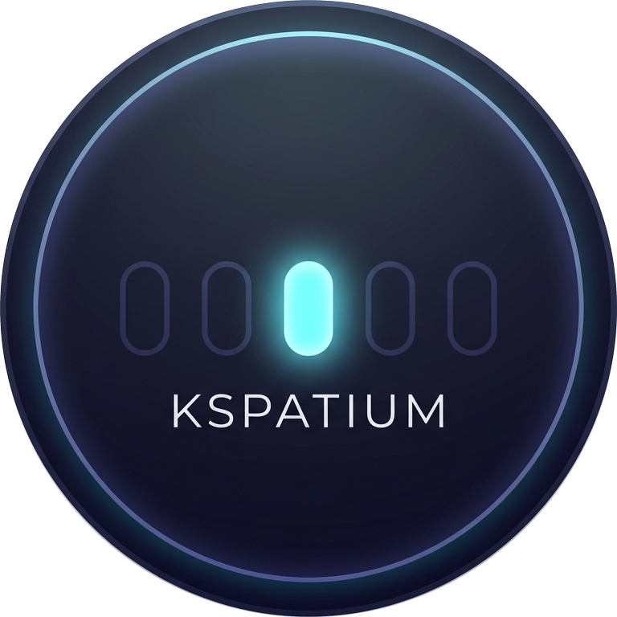
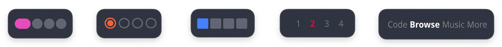

<div align="center">



# Kspatium

[](https://kde.org/plasma-desktop/)
[](https://www.linux.org/)
[](LICENSE)

A sleek, ultra-minimalist virtual desktop indicator and switcher widget crafted natively for **KDE Plasma 6**. *Designed for users who appreciate distraction-free elegance, fluid navigation, and deep desktop customization.*

<br/>



<br/>
</div>

---

## 🌟 Highlights & Features

- 🎯 **Minimalist UI** — Clean indicators with smooth transitions and active desktop tracking.
- 🎨 **5 Appearance Modes**:
  - **Dot** — Sleek pill indicators that expand gracefully for the active workspace.
  - **Ring** — Clean outlined rings with centered indicators.
  - **Square** — Modern square indicators.
  - **Desktop Name** — Displays actual desktop names from KWin (e.g., `Home`, `Work`), falling back to index numbers.
  - **Desktop Number** — Compact numeric indicators (`1`, `2`, `3`, …) bolded on the active desktop.
- 🌈 **Dynamic Wallpaper Colors** — Automatically adapts indicator and background tones to your active desktop wallpaper.
- 🎨 **Custom Color Picker** — Select custom active/inactive colors via native system color dialogs or hex codes (`#RRGGBB`).
- 📐 **Deep Customization** — Fine-tune dot/font sizes (8–24px), spacing factor (0.1–0.9), margins, and active bar dimensions.
- 🔢 **Fixed Dot Count** — Display a consistent count of indicators regardless of virtual desktop count.
- 🖱️ **Mouse Wheel Navigation** — Effortlessly switch desktops by scrolling over the widget with optional wrap-around.
- ⚙️ **Direct Desktop Management** — Add or remove virtual desktops on the fly through the right-click context menu.
- ⚡ **Plasma 6 Native** — Built with modern Kirigami and Plasma 6 APIs.

---

## ⚙️ Configuration

Right-click the widget on your panel or desktop and select **"Configure Kspatium…"**:

| Category | Option | Description |
| :--- | :--- | :--- |
| **Appearance** | **Shape** | `Dot`, `Ring`, `Square`, `Desktop Name`, or `Desktop Number` |
| **Appearance** | **Dot / Font Size** | Indicator size in pixels (`8px` to `24px`) |
| **Appearance** | **Spacing Factor** | Gap between indicators relative to size (`0.1` to `0.9`) |
| **Appearance** | **Side Margin** | Left and right margin spacing (`0px` to `10px`) |
| **Appearance** | **Active Width / Height** | Size dimensions of the active indicator bar |
| **Colors** | **Dynamic Colors** | Automatically pick tones matching your current wallpaper |
| **Colors** | **Custom Colors** | Enable custom active and inactive color overrides |
| **Colors** | **Active / Inactive Color** | Color picker dialog or hex input (`#RRGGBB`) |
| **Behavior** | **Switching Mode** | `Cycle` (continuous wrap) or `Fixed` (stops at boundaries) |
| **Behavior** | **Animation** | Transition duration in milliseconds |
| **Behavior** | **Desktop Management** | Allow quick add/remove desktops from context menu |
| **Behavior** | **Fixed Dot Count** | Display a fixed number of indicators (`1` to `20`) |

---

## 📦 Installation

> [!TIP]
> **Recommended methods**: **Option 1** (GUI) and **Option 3** (From Source / local `kpackagetool6`) are the most reliable methods.

### Option 1: Plasma Widget Explorer (Recommended — Easiest)
1. Right-click on your Plasma panel or desktop and select **Add Widgets…**
2. Click **Get New Plugins…** → **Install from File…**
3. Select the downloaded `.plasmoid` file (e.g. `org.sakibreza279.kspatium-v3.0.plasmoid`).

---

### Option 2: Using `kpackagetool6` with `.plasmoid` file

```bash
# New installation
kpackagetool6 -t Plasma/Applet -i org.sakibreza279.kspatium-v3.0.plasmoid

# Or upgrade existing
kpackagetool6 -t Plasma/Applet -u org.sakibreza279.kspatium-v3.0.plasmoid
```

> [!NOTE]
> **Version mismatch notice**: This command may sometimes fail or reject the package if versions change frequently or if a previously installed package with the same ID/version exists. If you encounter issues with Option 2, use **Option 1** or **Option 3** instead.

---

### Option 3: From Source (Recommended for Developers)

1. **Clone the repository**:
   ```bash
   git clone https://github.com/sakibreza229/kspatium.git
   cd kspatium
   ```

2. **Install directly using `kpackagetool6` local install**:
   ```bash
   # Install from current directory
   kpackagetool6 -t Plasma/Applet -i .
   ```

   *If you are updating an existing installation:*
   ```bash
   kpackagetool6 -t Plasma/Applet -u .
   ```

3. **Rebuild the Plasma shell cache**:
   ```bash
   kbuildsycoca6
   ```

> [!WARNING]
> Running `kbuildsycoca6` can occasionally freeze or temporarily stop the entire Plasma shell session. If your desktop becomes unresponsive after running this command, switch to a TTY (`Ctrl+Alt+F2`) and run `loginctl terminate-session self`, or simply **restart your machine**. Alternatively, you can restart Plasma Shell cleanly:
> ```bash
> systemctl --user restart plasma-plasmashell
> ```

---

## 📋 Requirements

- **KDE Plasma**: `6.0+`
- **plasma5support**: Package providing the `DataSource` executable engine

---

## 💬 Community & Support

Have questions, suggestions, or want to discuss the project? Join our community!

[](https://discord.gg/bBSby3HgmS)

---

## ☕ Support & Sponsoring

If you find **Kspatium** enhances your desktop experience and would like to support its continued development:

<br/>

<a href="https://ko-fi.com/sakibreza279">
  
</a>

<br/><br/>

- ☕ **Ko-fi**: [ko-fi.com/sakibreza279](https://ko-fi.com/sakibreza279)
- ⭐ **Star this repository** on [GitHub](https://github.com/sakibreza229/kspatium)

---

## 🤝 Contributing

Contributions, issues, and feature requests are welcome! Please check the [Contributing Guidelines](CONTRIBUTING.md) and [Code of Conduct](CODE_OF_CONDUCT.md).

---

## 📄 License

This project is licensed under the [GPL-3.0+](LICENSE) license.
